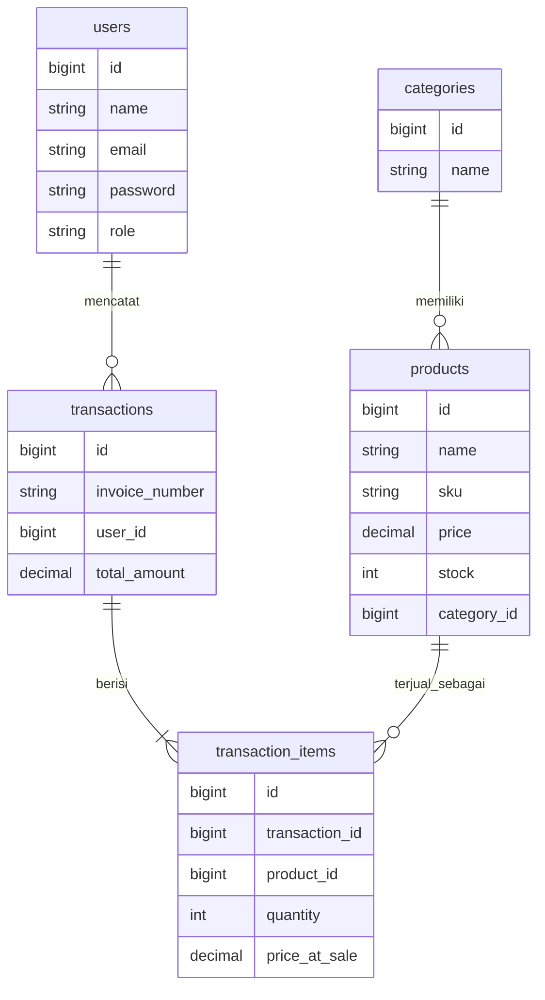

# POS Toko Alat Tulis


REST API untuk sistem kasir (Point of Sale) toko alat tulis. Kasir mencatat penjualan, stok berkurang otomatis, dan admin memantau penjualan lewat dashboard.

> Status: backend API selesai dan teruji. Frontend (React) dalam perencanaan.

<!-- TODO: tambahkan tangkapan layar atau GIF demo di sini kalau frontend sudah ada -->

## Fitur

- **Autentikasi** dengan token (Laravel Sanctum): register, login, logout, profil.
- **Dua role**: `admin` dan `kasir`, dengan hak akses berbeda.
- **Kategori dan produk**: kelola, cari, dan filter.
- **Transaksi**: checkout beberapa item sekaligus, stok berkurang otomatis, nomor invoice otomatis (`INV-YYYYMMDD-0001`), riwayat transaksi.
- **Dashboard admin**: penjualan hari ini, produk terlaris 30 hari, daftar stok menipis.
- **Keamanan**: pembatasan percobaan login (rate limit), validasi input ketat, tes SQL injection dan kontrol akses.

## Teknologi

| Bagian | Teknologi |
| --- | --- |
| Backend | Laravel 11 (PHP 8.2+) |
| Autentikasi | Laravel Sanctum (Bearer token) |
| Database | MySQL (pengembangan), SQLite memori (tes) |
| Pengujian | PHPUnit 11, GitHub Actions (CI) |

## Cara menjalankan

Kebutuhan: PHP 8.5+, Composer, dan MySQL.

```bash
git clone https://github.com/akbarprayudaputra6/pos_toko_alat_tulis.git
cd pos_toko_alat_tulis/backend

composer install
cp .env.example .env
php artisan key:generate
```

Atur koneksi database di `.env` (`DB_DATABASE`, `DB_USERNAME`, `DB_PASSWORD`), lalu:

```bash
php artisan migrate --seed
php artisan serve
```

API berjalan di `http://localhost:8000/api`.

<!-- TODO: tulis akun demo dari seeder, contoh: admin@toko.test / password -->

## Menjalankan tes

```bash
php artisan test
```

Tes memakai SQLite di memori, jadi database pengembangan Anda tidak tersentuh.

## Ringkasan endpoint

Semua endpoint berawalan `/api`. Selain register dan login, semua butuh header `Authorization: Bearer <token>`.

| Metode | Alamat | Fungsi | Akses |
| --- | --- | --- | --- |
| POST | `/register` | Daftar akun (selalu role kasir) | publik |
| POST | `/login` | Masuk, mendapat token | publik |
| GET | `/me` | Profil pengguna saat ini | login |
| POST | `/logout` | Cabut token | login |
| GET | `/categories` | Daftar kategori | login |
| GET | `/products` | Daftar produk (cari dan filter) | login |
| POST | `/transactions` | Checkout | login |
| GET | `/transactions` | Riwayat (kasir: milik sendiri, admin: semua), 15 per halaman | login |
| GET | `/transactions/{id}` | Detail transaksi | pemilik atau admin |
| GET | `/dashboard/summary` | Ringkasan hari ini, terlaris, stok menipis | admin |
| GET | `/dashboard/today-sales` | Penjualan hari ini | admin |
| GET | `/dashboard/top-products` | Produk terlaris | admin |

<!-- TODO: cocokkan tabel ini dengan `php artisan route:list`, dan tambahkan endpoint kelola kategori dan produk yang belum tercantum -->

Contoh checkout:

```http
POST /api/transactions
Authorization: Bearer <token>
Content-Type: application/json

{
  "items": [
    { "product_id": 1, "quantity": 2 },
    { "product_id": 5, "quantity": 1 }
  ]
}
```

## Skema database



<!-- TODO: sesuaikan nama dan jumlah kolom dengan migrasi Anda -->

## Keputusan teknis

Bagian ini menjelaskan *mengapa*, bukan hanya *apa*.

- **Harga disimpan sebagai snapshot** (`price_at_sale`). Harga produk bisa berubah, tetapi transaksi lama harus tetap menampilkan harga saat itu terjadi.
- **Checkout bersifat atomik.** Semua perubahan (pengurangan stok dan pencatatan item) berjalan dalam satu `DB::transaction()`. Jika satu item gagal, semuanya dibatalkan.
- **Total dan harga dihitung server.** Nilai `price`, `total_amount`, `user_id`, atau `invoice_number` yang dikirim klien diabaikan.
- **Role ditentukan server.** Pendaftaran publik selalu menghasilkan role `kasir`. Admin dibuat lewat seeder, sehingga tidak ada jalur eskalasi hak akses.
- **Kontrol akses per objek.** Kasir hanya bisa membaca transaksi miliknya sendiri (mencegah IDOR).
- **Arsitektur berlapis.** Route, controller tipis, FormRequest untuk validasi, dan service untuk logika bisnis.
- **Penanganan error terpusat.** Semua error dikembalikan sebagai JSON `{"message": ...}` dengan status yang tepat, tanpa membocorkan detail internal.
- **Konfirmasi password dicek di frontend.** API hanya menerima `name`, `email`, dan `password`.

## Pengujian dan keamanan

Pengujian otomatis mencakup:

- autentikasi, rate limit, dan pencabutan token,
- validasi input dan nilai ekstrem,
- logika stok, rollback, dan snapshot harga,
- kontrol akses antar role dan antar pengguna,
- serangan umum: SQL injection, XSS pada respons JSON, mass assignment, dan kebocoran pesan error.

Setiap `push` menjalankan seluruh tes di GitHub Actions.

## Rencana

- [ ] Frontend React (login dan halaman kasir)
- [ ] Void atau retur transaksi
- [ ] Laporan penjualan per periode dengan ekspor CSV
- [ ] Deploy dengan data demo

## Struktur proyek

```text
backend/
  app/
    Http/Controllers/    controller tipis
    Http/Requests/       validasi input
    Services/            logika bisnis
    Models/
  database/              migrasi dan seeder
  routes/api.php
  tests/Feature/         tes API
```

## Pembuat

Akbar Prayuda Putra — [github.com/akbarprayudaputra6](https://github.com/akbarprayudaputra6)
